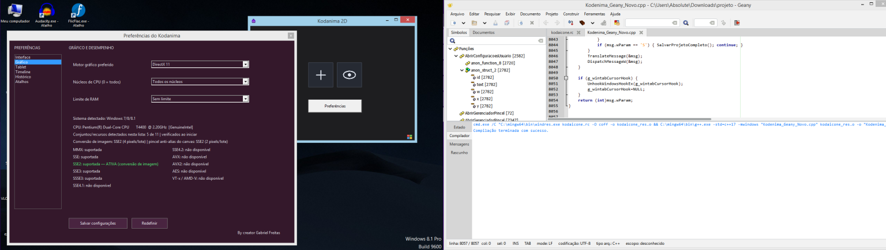
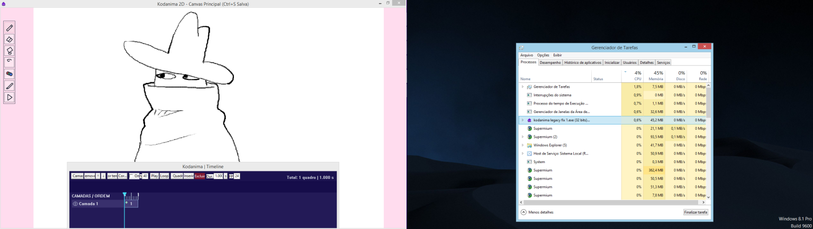

# Kodanima 2D

[README.md](https://github.com/user-attachments/files/33752070/README.md)
# Kodanima 2D

**Kodanima 2D** é um projeto de editor de desenho e animação 2D
desenvolvido em C++ para Microsoft Windows. A proposta é oferecer uma
interface nativa para desenhar, organizar quadros e trabalhar com uma
linha do tempo de animação.

## Recursos

-   Interface construída com APIs nativas do Windows.
-   Desenho e organização de quadros para animação 2D.
-   Linha do tempo para navegar e organizar quadros.
-   Suporte a imagens como PNG e BMP, conforme os recursos disponíveis
    na versão.
-   Recursos de áudio e importação de mídia conforme a implementação
    atual.
-   Suporte a caneta e mesa digitalizadora compatível, dependendo do
    driver e da configuração.
-   Configurações e atalhos de teclado.

## Tecnologias

-   **C++** --- linguagem principal.
-   **Win32 API** --- criação de janelas, controles, eventos e
    integração com o Windows.
-   **GDI** --- desenho da interface e operações gráficas compatíveis.
-   **DirectX** --- APIs gráficas utilizadas nas partes do programa que
    implementam aceleração gráfica; a disponibilidade depende do
    sistema, hardware e drivers.
-   **Wintab** --- integração com mesas digitalizadoras compatíveis,
    quando disponível.
-   **Instruções de CPU Intel e AMD** --- o programa pode detectar e
    aproveitar conjuntos de instruções compatíveis, como MMX, SSE e AVX,
    quando estiverem implementados e disponíveis no processador e no
    sistema. Nem toda instrução é usada em todas as operações.
-   **MinGW-w64 / GCC (G++)** --- compilação.
-   **Geany** --- ambiente de desenvolvimento utilizado.

## Sistemas operacionais

O projeto é voltado para **Microsoft Windows**. A compatibilidade com
Windows XP e versões posteriores depende das APIs utilizadas, das
bibliotecas vinculadas e da configuração de compilação. Recursos mais
recentes de DirectX, mídia ou instruções de CPU podem exigir versões
específicas do Windows, hardware ou drivers compatíveis.

## Uso dos recursos do computador

O Kodanima utiliza a **CPU** para processamento e cálculos, a **RAM**
para dados temporários e os recursos gráficos disponíveis para desenhar
a interface e processar conteúdo visual. Nas partes implementadas, o
**DirectX pode permitir aceleração por GPU**. O desempenho depende do
hardware, dos drivers, da versão do Windows e dos recursos efetivamente
habilitados.

A detecção de recursos do processador não significa que todas as
instruções Intel ou AMD sejam utilizadas em todas as tarefas. O programa
só deve executar instruções que sejam suportadas pelo processador e pelo
ambiente de execução.

## Compilação

O projeto é desenvolvido para ser compilado com **MinGW-w64/G++**, por
exemplo, usando o Geany. As bibliotecas e opções de linkagem podem
variar conforme a versão do código.

1.  Instale uma distribuição MinGW-w64 compatível.
2.  Abra o arquivo `.cpp` no Geany.
3.  Confira as opções de compilação e linkagem exigidas pelo código
    atual.
4.  Compile e teste no Windows de destino.

O comando de compilação pode variar entre versões do projeto.

## Como começar

1.  Baixe ou clone este repositório.
2.  Abra o código-fonte no Geany ou em outro editor compatível com C++.
3.  Compile com as dependências correspondentes à versão.
4.  Execute o programa e teste os recursos disponíveis.

## Limitações e compatibilidade

O projeto está em desenvolvimento. Nem todo formato de mídia ou recurso
planejado necessariamente está concluído ou disponível em todas as
versões. A aceleração gráfica, o suporte à mesa digitalizadora e a
exportação de mídia dependem da implementação e do ambiente.

## Relatar problemas

Ao reportar um erro, informe:

-   versão do Windows;
-   processador (Intel ou AMD e modelo, se souber);
-   compilador utilizado;
-   comando de compilação;
-   mensagem completa do erro;
-   etapas necessárias para reproduzir o problema.

## Licença

Este projeto é distribuído sob os termos da **GNU General Public License
v3.0 (GPL-3.0)**. Consulte o arquivo `LICENSE` do repositório para ver o
texto completo da licença. Se ele ainda não existir, adicione uma cópia
oficial da GPL-3.0 antes de publicar o repositório como licenciado.
